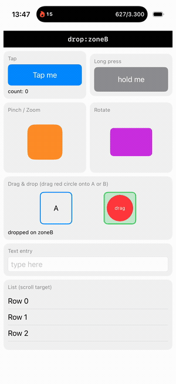
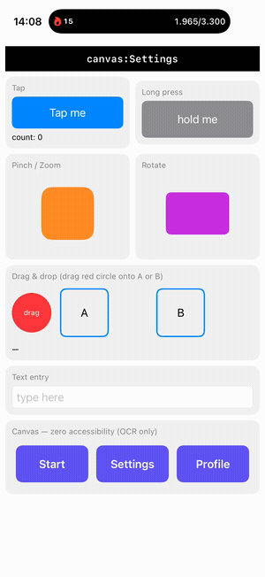

<div align="center">

# Wand

**Automate Apple simulators from an AI agent.**

A CLI for iPhone, iPad and Apple Watch with HID input commands, accessibility
snapshots and bounded Apple Vision OCR. One binary, zero third-party runtime
dependencies, and compact output for agents.

[](https://github.com/hanfann/wand/actions/workflows/ci.yml)
[](LICENSE)




<sub>An agent tapping, pinching, rotating, dragging-and-dropping, and typing — all verified through the accessibility tree, no screenshots.</sub>

</div>

---

## Current compatibility

On **Xcode 27.2**, native Watch Crown, 100 watch navigation transitions and all
six iPhone gesture/text outcomes pass. Input uses one persistent host DTUHID
connection, with no guest helper. See the [fix and outcome evidence](docs/validation/hid-closeout-2026-11-10.md).
Cold CoreSimulator startup can still stall; an input acknowledgement alone is
not a verified app outcome. iPad landscape gestures are also verified in the
[reliability report](docs/validation/reliability-2026-11-10.md); other runtime
versions still require qualification. Xcode 26.6 / iOS 26.5 has also passed all
seven portrait and three landscape iPhone fixture checks. Fresh simulator setup
remains unreliable on the small hosted runners; the report distinguishes those
failures from completed input tests.

## Why Wand

Agents are great at writing iOS apps and clumsy at the part that comes next:
**actually exercising them in the simulator.** Wand is built for that — and two
things set it apart from the rest of the field: it drives screens that expose
**zero accessibility** (via on-device OCR), and it's a **single, fully-open,
dependency-free binary**.

- 🧠 **No app setup required.** Reads the accessibility tree, and falls back to
  **Apple Vision OCR** for visible text. When a watch exposes no useful tree
  and OCR cannot read its pixel font, use screenshots and point coordinates.
- 🪙 **Token-efficient.** One compact line per element (`e5 Button "Save" #save @120,300`)
  with `find` / `assert` / `ui diff`, plus ordered batches and one-tool MCP.
- ⚡ **Fast.** A warm daemon keeps the connection, accessibility translator and HID
  client hot; see [measured latency and acceptance budgets](docs/performance.md).
- 👆 **Gesture commands.** Tap, long-press, swipe, **drag-and-drop**,
  **pinch/zoom**, **rotate**, multi-touch, unicode/emoji text — genuine HID events.
- ⌚ **Apple Watch + Digital Crown.** Drives watchOS simulators including the
  **Digital Crown** command (`wand crown down 3`). Verify delivery on your runtime;
  the Xcode 27.2 / 40mm Crown outcome checks pass.
- 🔌 **Agent-native.** Shares one skill between Claude and Codex; optional compact MCP.
- 🔒 **Local & private.** A `0600` per-user Unix socket. No network, no telemetry.
- 📦 **Zero third-party runtime deps.** Talks straight to Apple's `CoreSimulator`,
  `SimulatorKit`, `AccessibilityPlatformTranslation`, Vision and `simctl`.

|  | **Wand** | Argent | idb | Appium | Maestro |
|---|:--:|:--:|:--:|:--:|:--:|
| Agent-native (MCP + token-efficient snapshots) | ✅ | ✅ | ❌ | ❌ | ⚠️ |
| Drives screens with **zero accessibility** (on-device OCR) | ✅ | ❌ | ❌ | ❌ | ❌ |
| Pinch · rotate · drag-and-drop · multi-touch | ✅ | ⚠️ | ✅ | ✅ | ⚠️ |
| **Apple Watch + Digital Crown** | ✅ | ❌ | ✅ | ❌ | ❌ |
| Self-contained: one native binary, no Node/SDK runtime | ✅ | ❌ | ❌ | ❌ | ❌ |
| Fully open source, no proprietary parts | ✅&nbsp;MIT | ⚠️ | ✅ | ✅ | ✅ |
| Platforms | iOS · iPadOS · **watchOS** | iOS · Android | iOS | iOS · Android · web | iOS · Android |
| Live debugging & profiling (logs · network · RN tree · Instruments) | ❌ | ✅ | ⚠️ | ❌ | ❌ |

<sub>High-level summary, verified against each project's docs as of 2026. These are all good tools. The closest is <a href="https://github.com/software-mansion/argent">Argent</a> (Software Mansion): broader than Wand (cross-platform, deep debugging & profiling), but accessibility-only (no OCR), Node-based, and Apache-2.0 source <em>plus proprietary binaries</em>. Wand's niche: fully-open, dependency-free, OCR-driven, and the only one that drives <strong>Apple Watch + the Digital Crown</strong>.</sub>

## Quick start

```bash
# Install — builds the binary and installs the shared Claude/Codex skill
brew install https://raw.githubusercontent.com/hanfann/wand/main/Formula/wand.rb
wand setup

# …or from source
git clone https://github.com/hanfann/wand && cd wand && ./install.sh
```

```bash
wand boot "iPhone 17 Pro" --show
wand install ./MyApp.app && wand launch com.example.myapp

wand ui                       # what's on screen (token-efficient)
wand tap "Continue"           # by visible text — falls back to OCR
wand typein "#email" "a@b.co"
wand assert "#welcome" exists # → PASS / FAIL (exit 0/1)
```

> First call boots a background daemon and warms accessibility (a few seconds,
> once). Warm snapshots can be ~60 ms; actions also wait for UI settling. Requires
> macOS, full Xcode with the target Simulator SDK, and Swift 6.

### Xcode 27 and DeviceHub

Xcode 27 uses one persistent host DTUHID connection for touch, multitouch,
keyboard and native Watch Crown. No guest helper or SDK compilation is needed.
Xcode 26 and earlier retain Indigo. `info` reports the selected transport.
DeviceHub displays the actual simulator actions; Wand does not move the host mouse.
A broken connection fails explicitly. Inspect the screen and stop the selected
Wand daemon before reconnecting; ambiguous input is never replayed automatically.

For repeatable watch outcome checks on a disposable watch with Settings visible:

```sh
WAND_CROWN_CYCLES=50 swift examples/watch/touch-smoke.swift WATCH_UDID "$PWD/.build/release/wand" /tmp/wand-smoke
```

The suite checks navigation, drag, native Crown movement/restoration and batch
failure guards. `WAND_SMOKE_CYCLES=50` checks 100 navigation taps;
`WAND_CROWN_CYCLES=50` checks 100 Crown transitions. They are separate counts.

Keep the Mac unlocked for visible checks. Reuse one DeviceHub window, select
needed devices in its sidebar, and shut down task-owned simulators afterward.
The validation reports distinguish tested devices/runtimes from untested ones.

## The loop

1. **Observe** — `wand ui` (on-screen elements) · `wand see` (OCR every visible
   text) · `wand find <q>` · `wand scrollto <sel>`.
2. **Act** — `tap · typein · setvalue · clear · swipe · drag · dragdrop · pinch ·
   rotate`. Address things by `eN` ref, `#identifier`, `"label"`, or `x y`.
3. **Verify** — `wand assert <sel> [exists|gone|value=…|label=…]` (exit 0/1).

```text
$ wand ui
25 elements (on screen)
e1 Application "Wand Native" @201,437
e5 Button "Tap me" #tapButton @102,171
e16 TextField #textInput =type here @201,673
…

$ wand pinch "#map" 2.0      →  pinched
$ wand dragdrop "#card" "#trash"  →  drag-and-dropped
$ wand assert "#status" label=done  →  PASS exists e2 …
```

<details>
<summary><b>Full command reference</b></summary>

```
Observe
  ui [diff|full]            on-screen snapshot (diff = changes, full = incl. off-screen)
  see [accurate] [query]    bounded OCR with optional text filter (points)
  find <query>              elements matching label/id/value/role
  scrollto <sel>            scroll until an element is visible
  assert <sel> [exists|gone|value=..|label=..]
  wait <sel> [timeoutMs]
  screenshot [path]

Act   (sel = eN ref · #identifier · "label")
  tap <sel> | tap <x> <y> | tapocr <text>
  typein <sel> <text> | type <text> | setvalue <sel> <text> | clear <sel>
  key <hidUsage>
  swipe <x1 y1 x2 y2>
  drag <x1 y1 x2 y2 | fromSel toSel>
  dragdrop <x1 y1 x2 y2 | fromSel toSel>
  longpress <sel | x y> | pinch <sel | x y> <scale> | rotate <sel | x y> <radians>
  scroll up|down [clicks]   swipe-based scroll (iOS · iPadOS · watchOS)
  crown up|down [clicks]    watchOS Digital Crown detents (down = toward end of content)
  crown <delta> [steps]     raw crown turn (sign = direction)

App / device
  devices | boot <udid|name> [--show] | shutdown <udid|all>
  install <app> | launch <bundle> | terminate <bundle> | apps | open <url>
  logs [bundle] [seconds] | crashes [bundle]
  permission <grant|revoke|reset> <service> <bundle>
  record <start [path] | stop>

Setup / daemon
  setup | start | stop | status | info | mcp        (target a sim: --udid <udid>)
```

</details>

## Works without app setup

You do **not** need the app to add `testID`s. Visible text is enough:

- Native SwiftUI and RN `Text` / `Pressable` / `TextInput` already expose their
  text as labels — `wand tap "Continue"`.
- For anything else, `wand see` + `wand tapocr "<text>"` reads pixels via
  **on-device Apple Vision** (no key, no network). This even drives a HealthKit
  permission sheet or a canvas-rendered screen that exposes *zero* accessibility.

Adding `testID` / `accessibilityIdentifier` just makes targeting more precise.

<div align="center"></div>

The bottom row above is drawn with `Canvas` — it exposes **zero accessibility**.
Most tools (and accessibility-only agents) are blind to it. Wand isn't:

```console
$ wand ui            # accessibility tree
… no "Start" / "Settings" / "Profile" — they aren't accessibility elements

$ wand see           # on-device OCR
"Start" @79,702    "Settings" @200,703    "Profile" @322,702

$ wand tapocr "Settings"
tapped (ocr) "Settings" @200,703     →  #status = canvas:Settings
```

## For AI agents

- **Claude and Codex** — `wand setup` updates `~/.agents/skills/wand/SKILL.md`
  and links Claude's skill to it. The CLI plus skill needs no MCP tool catalog.
- **Optional compact MCP** — `wand mcp --compact` exposes one `run` tool.
  `wand setup --mcp` registers it with Claude; `wand mcp` and
  `wand setup --full-mcp` retain the separate legacy tools. Existing registrations
  are not silently replaced by setup. All MCP tools accept an optional `udid`.
- Pass `--udid <ID>` (CLI), `udid` (MCP), or `WAND_UDID` when multiple devices
  are booted; Wand refuses to guess a device.

### Fewer round trips and smaller observations

```sh
wand --udid <ID> batch '[["tap","40","80"],["ui","diff"]]'
# JSON can also arrive on stdin: wand --udid <ID> batch -
wand --udid <ID> see "Continue"           # only matching OCR regions
wand --udid <ID> see accurate "Continue"  # slower recognition, bounded to 5s
```

Batches run 1–64 known commands in order with normal settling, stop on the first
failure, and never roll back earlier actions. Observe between steps whose next
coordinates depend on the result. An ambiguous lost reply is never replayed.
Use `batch --summary <JSON|->` (MCP `run` accepts `summary: true`) when only the
final result matters. It returns the completed count and final result, or the
failed step and full error. Successful intermediate results are omitted. End with
`ui diff`, `assert`, or `screenshot` to verify the outcome; command completion alone
does not prove a screen transition. Omit summary to retain every step's output.
Use `find`, `assert` or `ui diff` on useful AX trees; app-only watch trees need
OCR or screenshots instead of repeated empty queries. Only capture images that
add evidence, and keep screenshot pixel coordinates distinct from touch points.

OCR runs in a disposable CPU worker (3s fast / 5s accurate deadline), keeping the
input daemon responsive after a Vision stall. Fast recognition and accurate fallback
share one captured frame. The latest exact PNG and point dimensions retain separate
results for both modes; every new operation captures again before checking that cache.
After an accurate timeout, automatic fallback pauses for 60s instead of repeatedly
waiting 5s. `see accurate` explicitly retries; success restores automatic fallback.
Cancellation does not trigger cooldown. Cooldown refuses input rather than accepting
uncertain text; input is never targeted from a time-based cache.

For lighter visual inspection, `wand screenshot /tmp/screen.png --preview 640`
keeps the full capture and derives `/tmp/screen.preview.png` with a longest edge of
640 pixels. Small captures reuse the full image without upscaling or duplicating it.
Add `--crop x y width height` to select a region in **source pixels**, measured from
the top left. Output is JSON with both paths, image dimensions and
`previewPixelToPoint`: `tapX = xOffset + previewX * xScale`, likewise for Y.
Use this mapping instead of the full screenshot's scale. Keep the original for
pixel/clipping audits; reduced previews can hide small defects. Full captures and
previews are user artifacts and are not automatically pruned.

CI skips macOS builds/live simulators only for a known documentation-only diff.
Code, test fixtures, workflows and unknown files retain full qualification. Manual
CI runs always qualify both Xcodes. A newer code run cancels superseded macOS jobs
for that branch/PR and Xcode; a docs-only push cannot cancel an active code test.

## How it works

```
agent ──► wand (CLI)            ──┐
agent ──► wand mcp (MCP server) ──┤ Unix socket (~/.wand/daemon-<udid>.sock, 0600)
                                   ▼
                              wandd (warm daemon)
                                   │  Obj-C engine, dlopen'd private frameworks
                    ┌──────────────┼───────────────┐
                    ▼              ▼                ▼
            DTUHID / Indigo   CoreSimulator   AccessibilityPlatformTranslation
              (HID input)     (SimDevice)     (AXPTranslator → a11y tree)  + Vision (OCR)
                    └──────────────┴────────────────┘
                          booted iOS Simulator
```

- **HID injection** uses one persistent DTUHID XPC connection on Xcode 27 for
  touch, multitouch, keyboard and Crown. It probes the service before input and
  refuses interrupted delivery without replay. Older Xcodes retain SimulatorKit
  Indigo. There is no guest helper or on-demand SDK compilation.
  The protocol reference is [Meta idb](https://github.com/facebook/idb/tree/main/FBSimulatorControl/HID);
  see `THIRD_PARTY_NOTICES`.
- **Accessibility** runs in a persistent, killable worker (5s request deadline)
  and drives `AXPTranslator` with a token delegate that bridges each
  attribute read to an async `SimDevice` XPC request, yielding the element tree in
  **point coordinates that match the tap space**.
- **OCR** captures the framebuffer in-process, then runs Apple Vision in a bounded
  CPU worker so model initialization cannot indefinitely block the input daemon.

## Showcase / tests

Two example apps with complex gestures double as the regression suite. Each mirrors
the last recognized gesture into a `#status` element, so gestures are verified
through the accessibility tree alone:

- `examples/native` — SwiftUI · `examples/native/build.sh`, then `examples/native/e2e.sh`.
- `examples/rnshowcase` — Expo / React Native · see `WAND_README.md` there.
- `examples/capture-grid.sh` — record an animation and tile it into one contact sheet
  (for sub-second animations too fast to screenshot); run with `--help`.

```bash
make build   # debug build
make test    # unit tests
WAND_UDID=<disposable-iOS-UDID> make e2e  # native gesture regression
```

## Limitations

- **Icon-only controls with no text and no accessibility label** are ambiguous to
  *any* automation — use coordinates, or add an `accessibilityLabel`.
- Apple **simulators** only (iOS, iPadOS, watchOS). Real devices and Android are out of scope.
- On **watchOS**, the AX tree may contain only an application. Try filtered OCR
  once; use screenshots and correctly scaled point coordinates if it fails.
- Pixel stability is a bounded heuristic, not an assertion that an app action succeeded.
- Accurate Vision OCR currently times out on this Xcode 27.2 host. Fast OCR
  remains usable, but missed or low-confidence labels require a screenshot.
  Neither mode guarantees recognition of custom pixel fonts.
- The prebuilt binary isn't notarized unless built with your own Apple Developer
  ID (`release.sh`); the `clone` and Homebrew paths build from source.
- `wand record` produces H.264 MP4; live FPS streaming isn't implemented.

## Credits

Wand is a fork of [**testa**](https://github.com/valewnrt/testa) by valewnrt,
used under the MIT License. Wand adds Apple Watch support — including **Digital
Crown** injection — and watchOS-tuned perception. Huge thanks to the testa
authors for the HID/accessibility engine this builds on.

## Project

- [CONTRIBUTING](CONTRIBUTING.md) · [CHANGELOG](CHANGELOG.md) · [Onboarding](ONBOARDING.md)
- License: [MIT](LICENSE)

<div align="center"><sub>Verified on Xcode 26 against iPhone 17 Pro (iOS) and Apple Watch Series 11 (watchOS, incl. Digital Crown), with SwiftUI + Expo/React Native showcases and a real production app.</sub></div>

## Performance validation

See [acceptance criteria and reproduction](docs/performance.md). The suite records
latency distributions, context bytes, framing failures, navigation outcomes and
memory/idle CPU. Fast OCR and accurate OCR have different quality/latency tradeoffs;
benchmark both on the target app. UI acknowledgement alone is not an outcome assertion.

`boot` is headless by default; `--show` opens DeviceHub (or Simulator on older
Xcode). `shutdown` also asks the selected Wand daemon to stop its workers. Fresh
observations are required before reusing positional `eN` references after input.

Latest reliability work isolates accessibility in a persistent worker, bounds
startup ownership and cancellation, and measures the parent plus worker memory.
See [the reliability report](docs/validation/reliability-2026-11-10.md) for measured
results, failed experiments and remaining platform limitations.

`wand cleanup --dry-run` previews diagnostic pruning; `wand cleanup` applies it.
Startup performs this maintenance at most daily. Only recognized inactive daemon
logs and OCR scratch are eligible: seven-day retention, at most 32 logs / 8 MiB
under pressure. Active owners, recordings, screenshots, unknown files and lock
files are preserved. Existing legacy helper caches are not used by this version.

MCP accepts cancellation while a request is running. Queued commands are skipped;
active socket waits are released and later batch steps stop at the next boundary.
Already-dispatched input or accepted CoreSimulator operations may still complete.
Cancelled requests receive no MCP reply; inspect state before issuing replacement input.
